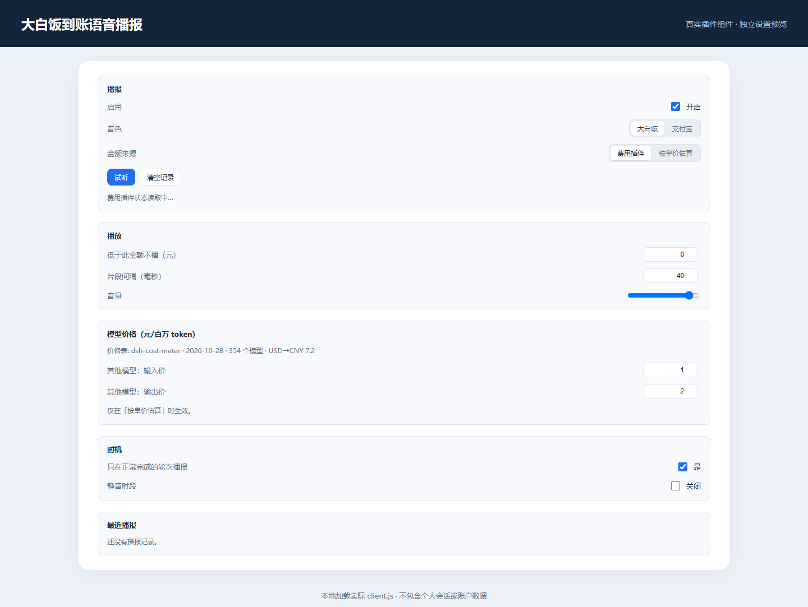

# 每轮扣款语音播报 · dsh-cost-voice


每轮会话结束，用支付宝或者「大白饭」的声音报一句本轮花了多少钱——「支付宝到账，零点一二元」。

音频全部打包在插件里，装好就能响：不联网、不调系统语音、不需要任何 TTS 服务。



## 功能

- **每轮结束自动播报**：一轮做完，报出这一轮的估算花费；刷新页面不会重播，后台标签页漏掉的只补最近一条
- **两种音色**：支付宝（收款语音片段拼接）；大白饭（小米 MiMo 音色克隆，0.01–1.00 元是整句录音，听起来最顺）
- **金额有两个来源**：装了 `dsh-cost-meter` 就直接用它记录的每轮费用；没装则按本轮模型单价估算（随包 354 个模型的价格表）
- **一个设置页搞定**：都在 **设置 → 插件 → 每轮扣款语音播报**，逐项解释见下方「设置说明」
- **可选，不打扰**：静音时段内不响；金额低于设定值时也不响

## 安装

```sh
dsh plugin --profile web add dsh-cost-voice
```

装完重启一次 `dsh web`，刷新页面，在 **设置 → 插件 → 每轮扣款语音播报** 里点一次「试听」——这同时解锁浏览器播放声音的权限，之后每轮结束就会响。

## 设置说明

| 设置 | 说明 |
|---|---|
| 音色 | 支付宝 / 大白饭 |
| 金额来源 | 费用插件（优先 `dsh-cost-meter`）/ 按单价估算 |
| 模型价格 | 按模型列出输入、输出单价（元/百万 token）；留空用价格表，填写即覆盖 |
| 低于此金额不播 | 默认 0，任何金额都播 |
| 片段间隔 | 拼接时每段之间的停顿，默认 40 毫秒 |
| 音量 | 0–1 |
| 只在正常完成的轮次播报 | 关掉后，中断或报错的轮次也会播 |
| 静音时段 | 例如 00:00–08:00 不播 |

## 听不到声音？

1. 先在插件页点一次「试听」。浏览器要求页面先被点过一次才允许出声。
2. 确认标签页停在这个页面：浏览器会把后台页面的定时器压到一分钟一次，播报会延迟。
3. 看设置里有没有打开「静音时段」，或把「低于此金额不播」设得比实际花费还高。
4. 系统音量、浏览器标签静音也要看一眼（标签上右键能静音）。

## 金额怎么算

装了 `dsh-cost-meter` 时，插件直接读它算好的每轮费用，和费用面板口径一致——推荐这样用。

没装时按本轮实际使用的模型估算：

`输入 × 输入价 + 输出 × 输出价 + 缓存读 × 缓存读价 + 缓存写 × 缓存写价`（元/百万 token）

单价来自 `dsh-cost-meter` 随包的 `docs/provider-pricing.json`（354 个模型，USD 折算汇率 7.2）；插件里也带了一份快照，所以没装费用插件也能估。表里没有的模型用「其他模型」兜底，可以在设置里改。

> 播报的是估算值，**不能当账单**。真实费用以各厂商账单和 `dsh-cost-meter` 为准。

## 已知限制

- 页面要开着、标签页在前台才会准时响；后台标签页会延迟。
- 大白饭 1 元以上走片段拼接，会比整句稍微机器感一点；支付宝整套都是拼接。
- 只支持 Web 版 GUI；桌面壳里同样走浏览器音频。

## 开发

```bash
node scripts/smoke-host.mjs      # 宿主半冒烟：轮次折叠、费用、价格目录、音频下发
node scripts/smoke-client.mjs    # 客户端半冒烟：加载器协议、页面树、金额计算、播放拼接
npm pack --dry-run               # 核对发布内容
```

| 路径 | 作用 |
|---|---|
| `index.js` | 宿主半：听 `turn/end`，折叠每轮用量与费用，出 `/api/cost-voice/*` |
| `client.js` | 客户端半：轮询、金额计算、Web Audio 拼接播放、插件页 |
| `assets/voices/` | 三套音色：`alipay-zh` 18 段、`dabaifan-clone` 17 段、`dabaifan-amounts` 100 句整句 |
| `assets/pricing.json` | 价格表快照（没装 `dsh-cost-meter` 时兜底） |
| `scripts/` | 音色渲染、ASR 校验、响度统一、离线冒烟（不随包） |
| `dev/` | 本地素材与截图（不随包、不进仓库） |

## 致谢与声明

- 支付宝播报片段来自开源项目 [Reathin/XVoice](https://github.com/Reathin/XVoice)（其 README 注明仅供娱乐）。
- 大白饭音色由小米 MiMo TTS 克隆生成；「大白饭到账」是二创梗，不是真实支付语音。
- 娱乐用途。本插件不联网、无遥测，只读会话的用量和轮次信息，不读写对话正文。

## 许可

[MIT](LICENSE)
